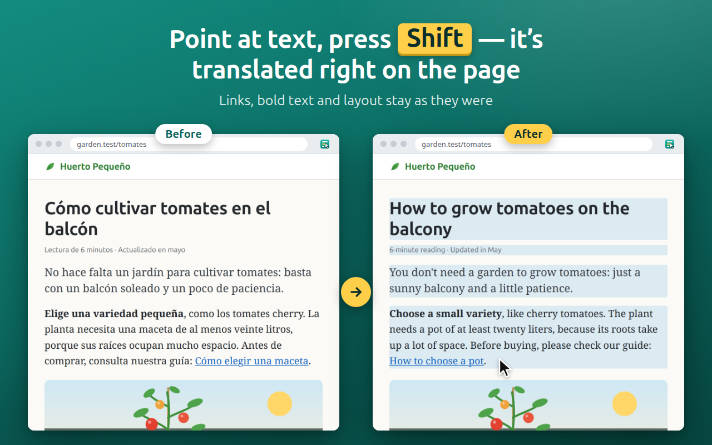
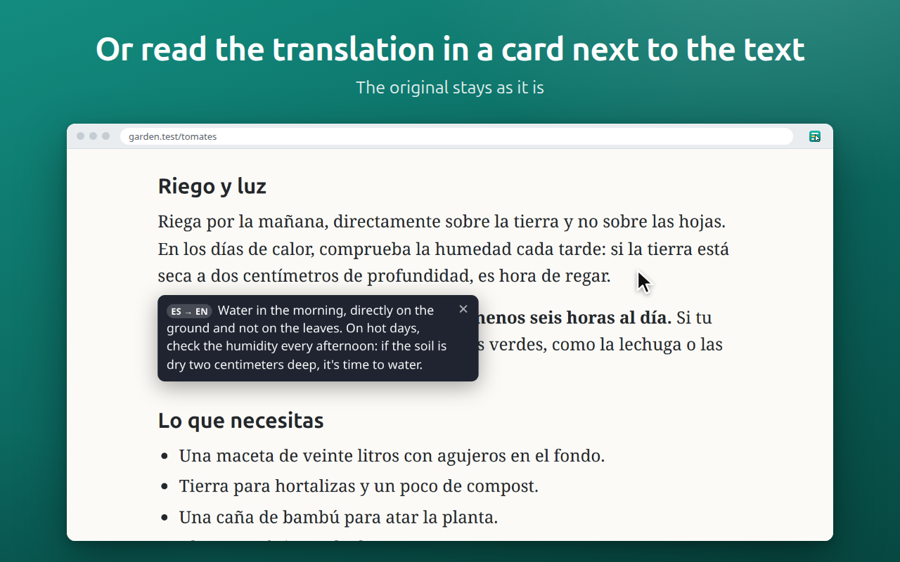

# Hover Translator — Translate Text In Place

[Русская версия](README.ru.md)

A Chrome extension that translates text right where it is. Point at a paragraph, heading, list item or table cell
and press **Shift**: the text is replaced with its translation, and links, bold text and the page layout stay as they
were. Press Shift again for the original; **Esc** brings back the whole page.

It works right after installing — no account and no key. By default it uses the translator built into Google Chrome,
which runs on your computer, so your text isn’t sent anywhere. DeepL and AI (OpenAI, Anthropic) can be connected
with your own key.





## Features

- Translation in place, or in a card next to the text.
- **Translate page**: what’s on screen first, the rest as you scroll.
- Choose how to trigger it: Shift, Alt, Ctrl, or hover with a delay (links, buttons and menus are skipped).
- Mini panel on the page to switch the language.
- Turn translation off on a particular site (email, bank).
- “Don’t translate these words” list for names and terms (DeepL and AI).
- 121 target languages (each translator supports its own set).
- English and Russian interface, light and dark theme.

## Install

**From the Chrome Web Store:** [Hover Translator](CHROME_WEB_STORE_URL)

**From source:**

1. Download the code: `git clone https://github.com/GITHUB_USER/hover-translator.git` (or “Code → Download ZIP”
   and unpack it).
2. Open `chrome://extensions` and turn on **Developer mode** (top right).
3. Click **Load unpacked** and select the `hover-translate` folder inside the repository.
4. A welcome page opens: choose the language to translate into and click **Set up translator** — Chrome downloads
   the language models once. Reload tabs that were open before installing.

Requirements: Chrome 116 or newer; the built-in translator needs **Chrome 138 or newer on a computer**. Without it,
use DeepL or AI with your own key.

## How to use

1. Point at some text and press and release **Shift** — it’s translated in place. Press again to bring back the
   original.
2. **Esc** brings back the original everywhere on the page.
3. Click the extension icon for settings: the language, how to trigger translation, **Translate page**, the mini
   panel, and “Translation quality” (choose the translator and paste keys).

| Shortcut | What it does |
|---|---|
| Shift (or Alt / Ctrl, as chosen) | Translate the text under the cursor; press again for the original |
| Esc | Show the original everywhere on the page |
| Alt+Shift+O (Mac: Ctrl+Shift+O) | Turn translation on or off |
| Alt+Shift+G (Mac: Ctrl+Shift+G) | Translate the page |

Shortcuts can be changed at `chrome://extensions/shortcuts`.

**Translators:**

- **Built into Chrome** (default) — free, runs on your computer, works offline once the models are downloaded.
- **DeepL** — your own API key; the free DeepL API plan includes 500,000 characters a month
  ([get a key](https://www.deepl.com/pro-api)).
- **DeepL, with built-in as backup** — switches to the built-in translator if DeepL fails or the monthly limit runs out.
- **AI** — your own OpenAI or Anthropic key; billed to your account.

Limitations: extensions can’t run on `chrome://` pages, the Chrome Web Store and some embedded frames; blocks longer
than 2,000 characters are skipped; “Translate page” covers up to 500 blocks at once and doesn’t pick up content that
loads later.

## Privacy

- With the built-in translator, nothing leaves your computer.
- DeepL, OpenAI or Anthropic receive text only if you select that service, paste your own key and click **I agree**.
  Only the text you translate is sent, directly from your browser to that service; the page address is not sent.
- Keys, settings and saved translations stay in your browser. Saved translations (DeepL and AI only) are kept for
  14 days; “More settings → Delete saved translations” removes them at once.
- No server of our own, no analytics, no ads.

Full details: [privacy policy](https://GITHUB_USER.github.io/hover-translator/privacy.html)
([source](docs/privacy.html)).

## Project structure

```
hover-translate/        the extension itself (Manifest V3, no build step) — this folder goes into the store package
  manifest.json
  background.js         service worker: requests to DeepL / OpenAI / Anthropic, saved translations, limits, badge, shortcuts
  content.js            on every page: finds the text under the cursor, replaces it, card, mini panel, notices
  shared.js             tables shared by all parts: languages, translators, default settings, consent, texts
  builtin.js            built-in translator status and model download (popup and welcome page)
  popup.html/.js/.css   the extension window
  welcome.html/.js/.css welcome page shown once after installing
  content.css           styles for translated text on pages
  _locales/en, ru       all interface texts
  icons/
  README.md             detailed technical notes (in Russian)
docs/                   GitHub Pages site: project page and privacy policy (English and Russian)
store/                  Chrome Web Store texts, dashboard answers, screenshots and promo images
scripts/pack.sh         builds dist/hover-translator-<version>.zip for the store
tests/                  automated checks
```

## Development

There is no build step: edit the files in `hover-translate/`, then press **Reload** on the extension’s card at
`chrome://extensions` (Chrome keeps the old service worker until then) and reload the tab you test on.

**Checks** live in `tests/` (Node.js and a local Chrome, nothing to install from npm). They cover the background
worker and shared tables in Node, the page script in headless Chrome with a stubbed `chrome.*`, the `_locales`
files (same keys in `en` and `ru`, no unused or missing messages), and live runs in a real Chrome with the built-in
translator. *How to run them — to be added.*

**Package for the store:**

```sh
bash scripts/pack.sh
```

It checks that `manifest.json` and the locale files are valid and that every file they refer to exists, then
writes `dist/hover-translator-<version>.zip` (the contents of `hover-translate/` without `*.md` files) and prints
its size and file list.

Store texts and answers for the Developer Dashboard are in `store/` (`listing-en.md`, `listing-ru.md`,
`dashboard.md`).

## Contributing and support

Questions, bugs and ideas: [GitHub Issues](https://github.com/GITHUB_USER/hover-translator/issues). Please don’t post
your API keys there — issues are public.

## License

[MIT](LICENSE) © 2026 nikimix

Google Chrome is a trademark of Google LLC. DeepL, OpenAI and Anthropic are trademarks of their owners. This project
is not affiliated with or endorsed by them.
