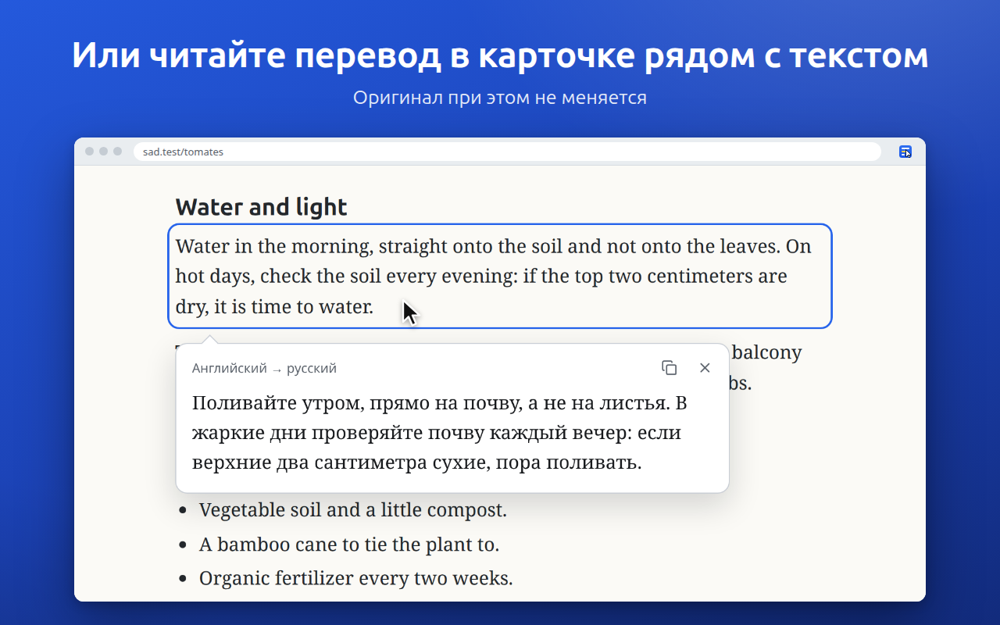

# Переводчик при наведении — перевод прямо на странице

[English version](README.md)

Расширение для Chrome, которое переводит текст прямо там, где он написан. Наведите курсор на абзац, заголовок,
пункт списка или ячейку таблицы и нажмите **Shift** — текст заменится переводом, а ссылки, выделение и вёрстка
останутся как были. Ещё раз Shift — вернётся оригинал, **Esc** — вернёт всю страницу.

Работает сразу после установки — без учётной записи и без ключа. По умолчанию переводит встроенный в Google Chrome
переводчик прямо на вашем компьютере, поэтому текст никуда не уходит. По желанию можно подключить DeepL и ИИ
(OpenAI, Anthropic) по своему ключу.




## Что умеет

- Перевод на месте — или в карточке рядом с текстом.
- **Перевести страницу**: сначала то, что на экране, остальное — по мере прокрутки.
- Как включать перевод: Shift, Alt, Ctrl или наведение с задержкой (ссылки, кнопки и меню при этом не переводятся).
- Мини-панель на странице, чтобы быстро сменить язык.
- Выключение перевода на отдельном сайте (почта, банк).
- Список «Не переводить эти слова» для названий и терминов (DeepL и ИИ).
- 121 язык перевода (у каждого переводчика свой набор).
- Окно расширения на русском и английском, светлая и тёмная тема.

## Установка

**Из магазина Chrome:** [Переводчик при наведении](CHROME_WEB_STORE_URL)

**Из исходного кода:**

1. Скачайте код: `git clone https://github.com/GITHUB_USER/hover-translator.git` (или «Code → Download ZIP» и
   распакуйте).
2. Откройте `chrome://extensions` и включите **Режим разработчика** (справа вверху).
3. Нажмите **«Загрузить распакованное расширение»** и выберите папку `hover-translate` внутри скачанного.
4. Откроется страница приветствия: выберите язык перевода и нажмите **«Подготовить переводчик»** — Chrome один раз
   скачает языковые модели. Вкладки, открытые до установки, обновите.

Что нужно: Chrome 116 или новее; встроенному переводчику — **Chrome 138 или новее на компьютере**. Если его нет,
подключите DeepL или ИИ по своему ключу.

## Как пользоваться

1. Наведите курсор на текст, нажмите и отпустите **Shift** — он переведётся на месте. Ещё раз — вернётся оригинал.
2. **Esc** возвращает оригинал везде на странице.
3. По значку расширения открываются настройки: язык, как включать перевод, **«Перевести страницу»**, мини-панель
   и «Качество перевода» (выбор переводчика и ключи).

| Сочетание | Что делает |
|---|---|
| Shift (или Alt / Ctrl — что выбрано) | Перевести текст под курсором; ещё раз — вернуть оригинал |
| Esc | Вернуть оригинал везде на странице |
| Alt+Shift+O (Mac: Ctrl+Shift+O) | Включить или выключить перевод |
| Alt+Shift+G (Mac: Ctrl+Shift+G) | Перевести страницу |

Сочетания меняются на странице `chrome://extensions/shortcuts`.

**Переводчики:**

- **Встроенный в Chrome** (по умолчанию) — бесплатно, работает на компьютере, после загрузки моделей — и без
  интернета.
- **DeepL** — по своему ключу; на бесплатном тарифе DeepL 500 000 знаков в месяц
  ([получить ключ](https://www.deepl.com/pro-api)).
- **DeepL, а если не вышло — встроенный** — переходит на встроенный, если DeepL не ответил или закончился месячный
  лимит.
- **ИИ** — по своему ключу OpenAI или Anthropic, оплата с вашего счёта.

Ограничения: расширения не работают на страницах `chrome://`, в магазине Chrome Web Store и в некоторых встроенных
окнах; отрывки длиннее 2000 знаков пропускаются; «Перевести страницу» за раз обрабатывает до 500 отрывков и не
переводит то, что подгрузилось позже.

## Ваши данные

- Со встроенным переводчиком ничего не покидает ваш компьютер.
- DeepL, OpenAI или Anthropic получают текст, только если вы выбрали этот сервис, вставили свой ключ и нажали
  **«Согласен»**. Отправляется только текст, который вы переводите, — из браузера прямо в этот сервис; адрес
  страницы не отправляется.
- Ключи, настройки и сохранённые переводы хранятся в вашем браузере. Сохранённые переводы (только DeepL и ИИ)
  хранятся 14 дней; «Дополнительно → Удалить сохранённые переводы» удаляет их сразу.
- Нет своего сервера, сбора сведений о пользователях и рекламы.

Подробно — в [политике конфиденциальности](https://GITHUB_USER.github.io/hover-translator/privacy-ru.html)
([исходник](docs/privacy-ru.html)).

## Из чего состоит

```
hover-translate/        само расширение (Manifest V3, без сборки) — эта папка уходит в архив для магазина
  manifest.json
  background.js         фоновая часть: запросы к DeepL / OpenAI / Anthropic, сохранённые переводы, лимиты, значок, горячие клавиши
  content.js            на каждой странице: находит текст под курсором, заменяет его, карточка, мини-панель, уведомления
  shared.js             общие таблицы: языки, переводчики, настройки по умолчанию, согласие, тексты
  builtin.js            состояние встроенного переводчика и загрузка моделей (окно и приветствие)
  popup.html/.js/.css   окно расширения
  welcome.html/.js/.css страница приветствия (один раз после установки)
  content.css           оформление переведённого текста на страницах
  _locales/en, ru       все тексты интерфейса
  icons/
  README.md             подробное техническое описание
docs/                   сайт на GitHub Pages: страница проекта и политика конфиденциальности (англ. и рус.)
store/                  тексты для магазина, ответы для панели разработчика, скриншоты и плитки
scripts/pack.sh         собирает dist/hover-translator-<версия>.zip для магазина
tests/                  автоматические проверки: tests/run.sh (см. «Разработка»)
```

## Разработка

Сборки нет: правьте файлы в `hover-translate/`, затем нажмите **«Обновить»** на карточке расширения в
`chrome://extensions` (до этого Chrome держит старую фоновую часть) и обновите вкладку, на которой проверяете.

### Проверки

Всё — в `tests/`, ставить из npm ничего не нужно. Нужны **Node.js 18+** и **Google Chrome** (или Chromium); живым
проверкам — **Chrome 138+** на компьютере и интернет: они скачивают языковые модели встроенного переводчика (в
первый раз — несколько минут) и отправляют в DeepL один запрос с выдуманным ключом.

```sh
tests/run.sh                  # всё (unit, page, live)
tests/run.sh --fast           # без живых проверок, около 2 минут
tests/run.sh --shots ПАПКА    # заодно сохранить скриншоты проверок в ПАПКУ
tests/run.sh page live/popup  # только наборы, в пути которых есть одно из слов
```

| Папка | Что проверяет |
|---|---|
| `tests/unit/` | `background.js` и `shared.js` в Node (`vm` с заглушкой `chrome.*`): сверка настроек, лимиты расхода, запросы к DeepL / OpenAI / Anthropic, ошибки, согласие, значок, установка; и файлы `_locales` — одинаковые ключи в `en` и `ru`, нет лишних и пропущенных сообщений, нет русского текста в коде |
| `tests/page/` | `content.js` в Chrome без окна на тестовых страницах с заглушкой `chrome.*`: считаются только настоящие нажатия и щелчки, Shift / наведение / Esc, карточка, уведомления, «Перевести страницу», выключение на сайте, мини-панель, согласие, подсказка о загрузке моделей встроенного переводчика |
| `tests/live/` | настоящее расширение в Chrome без окна с настоящим встроенным переводчиком: установка и приветствие, окно расширения на английском и русском (высота, ничего не обрезано), уведомления на сайте, горячие клавиши, обновление расширения при открытой вкладке |
| `tests/fixtures/` | тестовые страницы; `tests/lib/` — Chrome по CDP, сервер тестовых страниц, заглушка `chrome.i18n` |

`tests/run.sh` завершается с кодом 0, только если всё прошло. Сервер тестовых страниц берёт свободный порт (или
`HT_PORT`); Chrome ищется по `CHROME_PATH`, иначе `google-chrome` / `chromium` в `PATH`. Профили Chrome и копии
расширения — во временной папке (`HT_TMP` или системная), она удаляется после прогона. Живые наборы одного прогона
делят профиль, поэтому модели качаются один раз; `HT_PROFILE=<папка>` сохраняет их между прогонами. Любой набор
можно запустить и отдельно: `node tests/live/languages.test.js en`.

### Архив для магазина

```sh
bash scripts/pack.sh
```

Скрипт проверяет, что `manifest.json` и файлы сообщений — правильный JSON и что все файлы, на которые они ссылаются,
на месте, затем собирает `dist/hover-translator-<версия>.zip` (содержимое `hover-translate/` без файлов `*.md`) и
выводит размер и список файлов.

Тексты для магазина и ответы для панели разработчика — в `store/` (`listing-en.md`, `listing-ru.md`, `dashboard.md`).

## Вопросы и ошибки

Пишите в [GitHub Issues](https://github.com/GITHUB_USER/hover-translator/issues). Не публикуйте там свои ключи —
обращения видны всем.

## Лицензия

[MIT](LICENSE) © 2026 nikimix

Google Chrome — товарный знак Google LLC. DeepL, OpenAI и Anthropic — товарные знаки их владельцев. Проект не связан
с ними и не одобрен ими.
